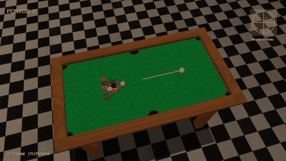
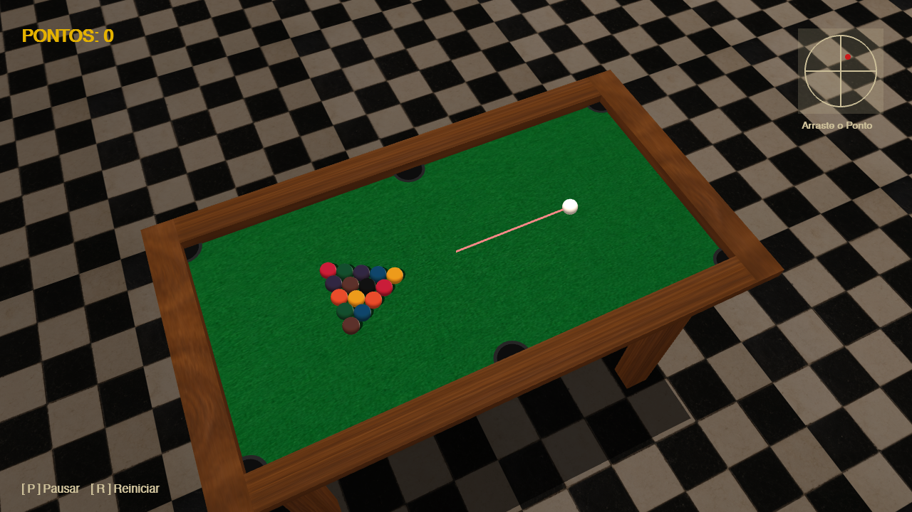

# Simulador de Sinuca de Boteco 3D

[](https://www.python.org/)
[](https://www.pygame.org/)
[](https://pyopengl.sourceforge.net/)
[](LICENSE)
[](https://github.com/Yoshi-404/sinuca-boteco-3d/actions)

> **Disponível em outros idiomas**: [English Version](README_EN.md)


---

## Demonstração Visual



*Visão geral da mesa texturizada com iluminação de Phong, sombras projetadas, física com rotação de bolas e interface HUD.*



---

## 1. Descrição do Projeto e Motivação

O **Simulador de Sinuca de Boteco 3D** é um ambiente interativo tridimensional desenvolvido em Python, Pygame e PyOpenGL. O cenário simula a atmosfera de uma mesa clássica de bilhar de bar brasileiro, apresentando:

- Mesa modelada com feltro verde texturizado, bordas em madeira polida, caçapas com profundidade e pernas torneadas.
- Piso quadriculado estilo boteco retrô com texturização e iluminação difusa/especular.
- Bolas de sinuca renderizadas como esferas quádricas sob o modelo de iluminação de **Phong** (ambiente, difusa e especular com brilho ajustado).
- Física customizada de rolamento, colisões elásticas entre esferas e amortecimento contra as tabelas da mesa.
- Sistema de aplicação de efeito na bola branca (**Spin / English**) em tempo real.
- Sistema de partículas tridimensionais (pó de giz azul gerado no ponto de impacto do taco).
- Efeitos sonoros de tacada, colisão e encaçapamento, além de trilha sonora ambiente no menu.

### Evolução Acadêmica

A escolha deste tema tem um valor pessoal e técnico: é a reescrita e aprimoramento completo de um projeto final desenvolvido durante os estudos do autor na **Universidade de Wakayama (Japão)**. 

A versão original era preliminar: usava apenas projeção ortogonal (resultando em uma mesa achatada sem profundidade), não possuía caçapas modeladas tridimensionalmente e tinha recursos gráficos limitados.

Esta versão definitiva demonstra o domínio de tópicos avançados de Computação Gráfica:
- **Ilusão de Profundidade nas Caçapas**: Modelagem concêntrica utilizando testes de profundidade (Z-buffer).
- **Câmera em Perspectiva Dinâmica**: Órbita esférica livre e zoom com matrizes matemáticas.
- **Camada de Interface HUD 2D**: Painel vetorial para controle de efeito na bola.
- **Mipmapping e Filtragem Anisotrópica**: Prevenção de serrilhamento (*aliasing*) e padrões de Moiré no chão texturizado e nas bolas.
- **Arquitetura Modular**: Separação clara entre constantes, carregamento de assets, geometria/interface, entidades físicas e loop principal.

---

## 2. Tecnologias e Bibliotecas Utilizadas

- **[Python](https://www.python.org/) (3.10+)**: Linguagem base do projeto.
- **[Pygame](https://www.pygame.org/)**: Gerenciamento de janelas, loop de eventos (mouse e teclado), temporização a 60 FPS e pipeline de áudio (mixer).
- **[PyOpenGL](https://pyopengl.sourceforge.net/) (`GL`, `GLU`)**: Pipeline de renderização 3D por hardware, matrizes de transformação, quádricas esféricas, cálculo de normais e iluminação.
- **[PyInstaller](https://pyinstaller.org/)**: Empacotamento do executável nativo para Windows (.exe) via GitHub Actions CI/CD.

---

## 3. Justificativa da Escolha das Projeções

O projeto faz o uso híbrido e estratégico de duas projeções matemáticas:

### Projeção em Perspectiva (`gluPerspective`)
Utilizada para o mundo tridimensional (mesa, bolas, tacos, partículas e piso).
- **Justificativa**: A perspectiva introduz o efeito de *foreshortening* (encurtamento visual conforme a distância em relação à câmera), indispensável em um jogo de sinuca para que o jogador tenha percepção real de distância, profundidade e angulação na hora de planejar a tacada.

### Projeção Ortográfica (`gluOrtho2D`)
Utilizada exclusivamente para a camada de interface (HUD de pontuação, mostrador interativo de spin, telas de pause, menu e game over).
- **Justificativa**: Elementos de interface bidimensional devem permanecer estáticos e perfeitamente legíveis na tela, sem sofrer distorções de escala ou perspectiva causadas pela movimentação da câmera 3D.

---

## 4. Controles de Interação

| Controle | Ação |
| :--- | :--- |
| **Mouse (Botão Esquerdo - Mesa)** | Clique e arraste para trás a partir da bola branca para ajustar força e direção. Solte para disparar. |
| **Mouse (Movimento Livre)** | Movimenta a câmera em órbita ao redor do centro da mesa. |
| **Scroll do Mouse (Roda)** | Aproxima (*Zoom In*) e afasta (*Zoom Out*) a câmera da mesa. |
| **HUD (Canto Superior Direito)** | Clique e arraste o ponto vermelho para aplicar efeito de rotação (*Spin/English*) na bola branca. |
| **Setas Direcionais (Teclado)** | Ajuste fino do efeito (*Spin*) na bola branca. |
| **Tecla `[ P ]`** | Pausa e despausa a partida. |
| **Tecla `[ R ]`** | Reinicia a partida (reagrupa as bolas no triângulo e zera o placar). |

---

## 5. Estrutura do Código

O projeto foi dividido em módulos coesos para facilitar a manutenção e legibilidade:

```text
sinuca-boteco-3d/
├── .github/
│   └── workflows/
│       └── build.yml          # CI/CD: Compilação Windows e GitHub Releases
├── assets/
│   ├── README.md              # Resumo e metadados dos assets
│   ├── chao_boteco.jpg        # Textura do chão de boteco
│   ├── feltro.jpg             # Textura do feltro verde da mesa
│   ├── madeira.jpg            # Textura de madeira da mesa e pernas
│   ├── poolballs[0-8].jpg     # Texturas das bolas de sinuca (0 a 8)
│   ├── start_music.mp3        # Trilha sonora de introdução
│   └── tacada.wav             # Áudio do impacto do taco
├── docs/
│   └── screenshots/           # Mídias para documentação (GIF e PNG)
├── assets.py                  # Carregadores seguros de texturas, sons e caminhos
├── constants.py               # Dimensões da mesa, cores, limites de física e estados
├── entities.py                # Classes Ball (física e rolamento), Particle e Rack
├── graphics.py                # Primitivas gráficas, textos, HUD e projeção de raios
├── main.py                    # Loop principal, gerenciamento de eventos e render pass
├── requirements.txt           # Dependências do projeto
├── CREDITS.md                 # Detalhes de autoria, proveniência e licença das mídias
├── LICENSE                    # Licença MIT
├── README.md                  # Documentação em Português
└── README_EN.md               # Documentation in English
```

---

## 6. Instruções de Instalação e Execução

### Opção A: Executar pelo Código-Fonte (Python)

1. Clone o repositório:
   ```bash
   git clone https://github.com/Yoshi-404/sinuca-boteco-3d.git
   cd sinuca-boteco-3d
   ```

2. Crie e ative um ambiente virtual (recomendado):
   ```bash
   python3 -m venv venv
   # No Linux/macOS:
   source venv/bin/activate
   # No Windows (PowerShell):
   .\venv\Scripts\Activate.ps1
   ```

3. Instale as dependências:
   ```bash
   pip install -r requirements.txt
   ```

4. Execute o jogo:
   ```bash
   python main.py
   ```

### Opção B: Download do Executável para Windows (.exe)

Você pode baixar a versão pré-compilada pronta para jogar sem necessidade de instalar Python:
1. Acesse a aba **[Releases](https://github.com/Yoshi-404/sinuca-boteco-3d/releases)** no GitHub.
2. Baixe o executável direto `Simulador-Boteco-3D.exe` ou o pacote `.zip` da versão mais recente (`Simulador-Boteco-3D-Windows.zip`).
3. Execute `Simulador-Boteco-3D.exe`.

---

## 7. Origem e Licença dos Recursos de Mídia

Todos os recursos visuais e sonoros foram obtidos ou criados sob termos permissivos e estão documentados em detalhes no arquivo [CREDITS.md](CREDITS.md):

| Arquivo | Origem | Licença / Termos |
| :--- | :--- | :--- |
| `assets/feltro.jpg` | Gerado por IA (OpenAI ChatGPT / DALL-E 3, C2PA) | Termos de Uso OpenAI / Acadêmico |
| `assets/madeira.jpg` | Gerado por IA (OpenAI ChatGPT / DALL-E 3, C2PA) | Termos de Uso OpenAI / Acadêmico |
| `assets/chao_boteco.jpg` | Gerado por IA (OpenAI ChatGPT / DALL-E 3, C2PA) | Termos de Uso OpenAI / Acadêmico |
| `assets/poolballs*.jpg` | Modelado e gerado no GIMP | Domínio Público / Licença MIT |
| `assets/tacada.wav` | Gravado por Russ Garrett (Freesound #2103) | [CC Sampling+ 1.0](https://creativecommons.org/licenses/sampling+/1.0/) / CC BY 3.0 |
| `assets/start_music.mp3` | Composto no FL Studio 11 (2014, 140 BPM) | Royalty-Free / Uso não comercial |

---

## 8. Licença

Este projeto é distribuído sob os termos da licença **MIT**. Consulte o arquivo [LICENSE](LICENSE) para mais informações.
